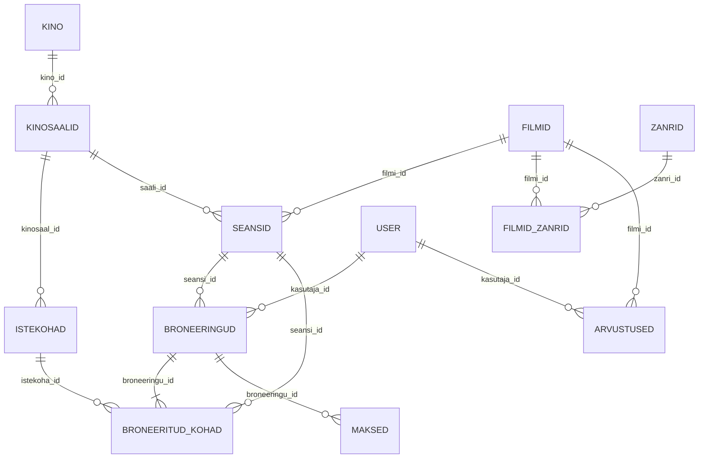

# Kinoandmebaasi kirjeldus

See dokument kirjeldab andmebaasi struktuuri, seoseid, lähteprojektiga võrreldes tehtud muudatusi
ja seda, kuidas `project.sql` vastab Django ORM-i loodud skeemile.

## Mõisted lühidalt

| Mõiste | Tähendus |
| --- | --- |
| **Primaarvõti (PK)** | Veerg, mis identifitseerib rea üheselt (siin alati `id`). |
| **Võõrvõti (FK)** | Veerg, mis viitab teise tabeli primaarvõtmele. Andmebaas ei luba viidata reale, mida pole olemas. |
| **1:N seos** | Üks rida ühes tabelis on seotud mitme reaga teises tabelis (üks kino → mitu saali). |
| **M:N seos** | Mitu-mitmele seos (filmil mitu žanrit ja žanris mitu filmi). Teostatakse vahetabeliga. |
| **UNIQUE** | Väärtus või väärtuste kombinatsioon ei tohi korduda. |
| **CHECK** | Tingimus, mida iga rida peab täitma (nt hinnang 1–5). |
| **EXCLUDE** | PostgreSQL-i piirang, mis keelab "kattuvad" read. Siin: samas saalis kattuvad seansid. |
| **Indeks** | Abistruktuur, mis kiirendab otsingut (nt seansid alguse aja järgi). |
| **Migratsioon** | Django fail, mis muudab skeemi kontrollitud ja korratavalt. |

## ER-diagramm

(Mermaid'is ei saa kasutada täpitähti, seetõttu on diagrammis `ZANRID`. Päris tabel on `žanrid`.)

## Tabelid

| Tabel | Django mudel | Sisu | Olulised piirangud |
| --- | --- | --- | --- |
| `user` | `User` | kasutajad | `user` (kasutajanimi) ja `email` UNIQUE |
| `kino` | `Cinema` | kinod | (nimi, linn) UNIQUE |
| `kinosaalid` | `CinemaHall` | saalid | FK kino; (kino, nimi) UNIQUE; mahutavus > 0 |
| `istekohad` | `Seat` | istekohad | FK saal; (saal, rida, koht) UNIQUE |
| `filmid` | `Movie` | filmid | pikkus > 0 |
| `žanrid` | `Genre` | žanrid | nimi UNIQUE |
| `filmid_zanrid` | `MovieGenre` | filmi ja žanri M:N vahetabel | (film, žanr) UNIQUE |
| `seansid` | `Screening` | seansid | FK film, saal; lõpp > algus; hind ≥ 0; **samas saalis ei kattu** |
| `broneeringud` | `Booking` | broneeringud | FK kasutaja, seanss; summa ≥ 0 |
| `broneeritud_kohad` | `BookedSeat` | piletid (1 rida = 1 koht) | FK broneering, seanss, istekoht; (seanss, istekoht) UNIQUE |
| `maksed` | `Payment` | maksed | FK broneering; summa ≥ 0; viide UNIQUE |
| `arvustused` | `Review` | arvustused | FK kasutaja, film; hinnang 1–5; (kasutaja, film) UNIQUE |

### Seosed

- **1:N:** kino → saalid → istekohad; saal → seansid; film → seansid; kasutaja → broneeringud;
  seanss → broneeringud; broneering → piletid; broneering → maksed (ka ebaõnnestunud katse +
  edukas makse); kasutaja → arvustused; film → arvustused.
- **M:N:** filmid ↔ žanrid läbi vahetabeli `filmid_zanrid` (`Movie.genres = ManyToManyField(through='MovieGenre')`).
  Vahetabelil on oma primaarvõti `id`, kaks võõrvõtit ja UNIQUE (filmi_id, žanri_id).
  Ka piletitabel `broneeritud_kohad` on sisuliselt M:N seos broneeringute ja istekohtade vahel,
  millel on lisaandmed (hind, seanss).

### Kustutamise käitumine (`on_delete`)

- `CinemaHall.cinema` → `PROTECT`: kino ei saa kustutada, kui tal on saale.
- Kõik teised võõrvõtmed → `CASCADE`: näiteks broneeringu kustutamisel kustuvad ka selle piletid ja maksed.

## Lähteprojektiga võrreldes tehtud muudatused

Lähtekoht oli TA-24A-3 commit `63aaf6f`. Probleemid mõõtsin, käivitades algse seederi testandmebaasis.

### Skeem (migratsioon `0003_schema_integrity.py`)

| Muudatus | Põhjus |
| --- | --- |
| `user.user` ja `user.email` UNIQUE, `email` on `EmailField` | Kaks kasutajat ei tohi jagada kasutajanime ega e-posti. |
| `žanrid.nimi` UNIQUE | Vana SQL-i indeks (id, nimi) ei takistanud topeltžanre. |
| `kino` (nimi, linn) ja `kinosaalid` (kino, nimi) UNIQUE | Väldib topeltkirjeid. |
| CHECK: mahutavus > 0, filmi pikkus > 0, hinnad ja summad ≥ 0 | Andmebaas ei luba võimatuid väärtusi. |
| `arvustused.hinnang` NOT NULL + CHECK 1–5 andmebaasis | Enne oli 1–5 ainult Django vormivalidaator ja andmebaas lubas suvalist arvu. |
| (kasutaja, film) UNIQUE arvustustes | Algne seeder lõi 4 topeltarvustust. |
| **EXCLUDE**: samas saalis seansid ei kattu (`btree_gist`) | Algne seeder lõi 4 kattuvat seanssi. |
| `makse_viide` UNIQUE | Makseviide peab olema ühene. |
| Valikud (`choices`) staatustele, makseviisidele, ekraanitüübile, vanusepiirangule | Ühtlustab väärtused. |
| `loodud` väljad: `auto_now_add` → `default=timezone.now` | Seeder saab salvestada realistliku ajaloo (broneering enne seanssi). |
| Indeks `seansid.algus_aeg` | Kinokava päringud on kuupäeva järgi. |
| `pealkiri` ja `filmi_pikkus` ilma vaikeväärtuseta | Tühi pealkiri ja 0-minutiline film polnud mõistlikud vaikeväärtused. |

Algsed migratsioonid `0001` ja `0002` on muutmata. Uus migratsioon tuleb nende järel, nii et
skeemi ajalugu on näha.

### Algse `project.sql` vead, mis on parandatud

Algne fail oli DataGripi eksport ja sisaldas vigu:

- `istekohad.id` oli ühtaegu primaarvõti **ja** võõrvõti saali tabelisse (istekohal polnud eraldi saali veergu);
- `istekohad.rida` oli UNIQUE, nii et terves andmebaasis saanuks olla ainult üks rida "A";
- filmide ja žanrite vahetabel puudus (M:N seost polnud);
- `user.phone_number` oli `numeric(128)`, nii et number nagu `+372 5…` ei mahtunud;
- `broneeringud.kasutaja_id` oli `integer`, aga `user.id` on `bigint`;
- `seansid.saali_id` oli `integer`, aga `kinosaalid.id` on `bigint`;
- failis olid DataGripi ja omaniku read (`owner to "Admin"`, `comment on database postgres`) ning skeem `kinoprojekt`.

Uus `project.sql` kirjeldab sama skeemi, mille Django migratsioonid loovad.

### Seeder

| Algne seeder | Uus seeder |
| --- | --- |
| `filmid_zanrid` jäi tühjaks (0 rida) | Igal filmil on 1–3 sobivat žanrit (40 seost). |
| Seansid juhuslikel aegadel; 4 kattusid samas saalis | Igal saalil on päevakava 11:00–22:00: reklaamid + film + 15 min koristus, algus veerandtunni täpsusega. |
| 42 broneeringut tehti pärast seansi algust | Broneering tehakse alati enne seanssi ja mitte tulevikus. |
| 17 tühistatud broneeringul oli edukas makse; 29 kinnitatul polnud | Staatused klapivad: kinnitatud → edukas makse, tühistatud → tagastatud/ebaõnnestunud, ootel → ootel. |
| 59 arvustust filmidele, mida kasutaja polnud näinud | Arvustab ainult kasutaja, kelle kinnitatud seanss on juba lõppenud. |
| Filmi pealkirjad olid ingliskeelsed fraasid ("Innovative dedicated time-frame") | Väljamõeldud eestikeelsed filmid koos sobiva pikkuse, vanusepiirangu ja keelega. |
| Kino nimes oli teine linn kui aadressis | Kinod Tallinnas, Tartus ja Pärnus, linnale vastava postiindeksiga. |
| Telefonid USA formaadis | `+372 5xxxxxxx` |

Seeder loob andmed võõrvõtmete järjekorras: kasutajad → kinod → saalid → istekohad → žanrid →
filmid → filmi-žanri seosed → seansid → broneeringud → piletid → maksed → arvustused.
Juhuarvude seeme on fikseeritud (`SEED = 2403`), nii et tulemus on korratav. Kuupäevad on
arvutatud tänase päeva suhtes (7 päeva tagasi kuni 6 päeva ette).

Ridade arv ühe käivitusega (kontrollitud):

| Tabel | Ridu |
| --- | --- |
| user | 80 |
| kino / kinosaalid / istekohad | 3 / 9 / 966 |
| žanrid / filmid / filmid_zanrid | 10 / 22 / 40 |
| **seansid** | **631** |
| **broneeringud** | **1630** |
| **broneeritud_kohad** (piletid) | **3757** |
| **maksed** | **1766** |
| **arvustused** | **248** |

Kuna seeme on fikseeritud, on kasutajate, seansside, broneeringute ja piletite arv igal
käivitusel sama. Maksete ja arvustuste arv võib veidi kõikuda, sest see sõltub hetke
kellaajast: milline seanss on juba lõppenud ja milline broneering on veel "ootel".

## `project.sql` ja ORM-i skeemi võrdlus

Kontrollisin seda nii: rakendasin ühes testandmebaasis Django migratsioonid ja käivitasin teises
`project.sql`. Seejärel võrdlesin `information_schema` ja `pg_constraint` andmeid:

| Mida võrreldi | Tulemus |
| --- | --- |
| Veerud: nimi, tüüp, pikkus, NULL lubatud (70 veergu) | identsed |
| PRIMARY KEY, UNIQUE ja FOREIGN KEY piirangud (36) | identsed |
| CHECK- ja EXCLUDE-piirangud | samad. Django lisab kolm kattuvat `>= 0` kontrolli (`PositiveSmallIntegerField`), mida rangemad `> 0` / `1–5` kontrollid juba katavad. |

Sisulised erinevused, mis on ka `project.sql` päises kirjas:

- Django annab indeksitele räsiga nimed (nt `user_email_54dc62b2_uniq`), `project.sql`-is on loetavad nimed.
- Django võõrvõtmed on `DEFERRABLE INITIALLY DEFERRED` ja `on_delete` käitumist täidab Django.
  `project.sql` kirjeldab sama käitumist `ON DELETE CASCADE/RESTRICT` reeglitega.
- Vaikeväärtused (`ekraani_tüüp = '2D'`, `väikeväärtus = false`, `staatus = 'ootel'`, `loodud = now()`)
  on `project.sql`-is andmebaasi `DEFAULT`-id. Django määrab need Pythonis enne `INSERT`-i, seega
  ORM-i skeemi veergudel `DEFAULT`-i pole.

Skeemi ainus omanik on Django: `project.sql` on planeerimis- ja esitlusdokument, mitte paigaldusskript.

## Teadaolevad piirangud ja edasiarendus

- Reeglid "pileti seanss = broneeringu seanss" ja "istekoht asub seansi saalis" hõlmavad mitut
  tabelit. Django ei toeta liitvõõrvõtmeid, seega kontrollitakse neid `BookedSeat.clean()`
  meetodis, testides ja `scripts/kontroll.sql` päringutes. Neid saaks jõustada ka triggeriga.
- Tühistatud broneeringu piletiread jäävad ajaloo jaoks alles ja koht jääb sellel seansil hõivatuks.
  Päris süsteemis tuleks tühistamisel piletiread kustutada või märkida vabaks.
- Veeru nimi `filmid.väikeväärtus` (Django väli `is_featured`) on lähteprojektist ja eksitav.
  Ühilduvuse huvides jätsin selle muutmata; selgem nimi oleks `esiletostetud`.
- Kasutajate tabel on projekti oma (`user`), mitte Django sisseehitatud `auth_user`. Demokasutajatel
  on "kasutamatu" parooliräsi, nii et nendega ei saa sisse logida.
